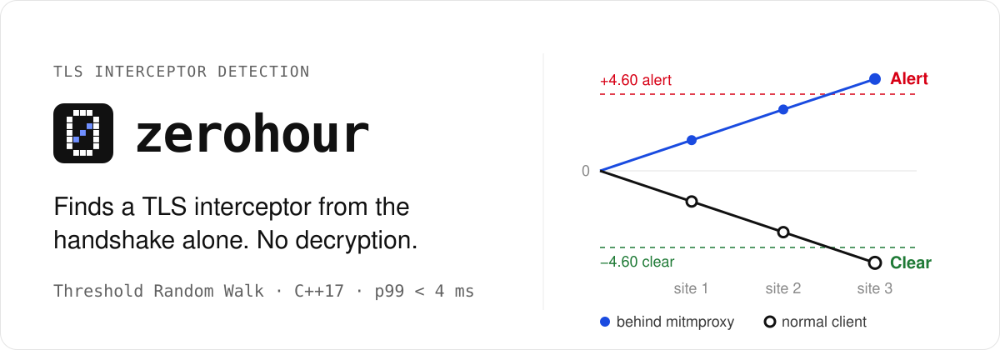
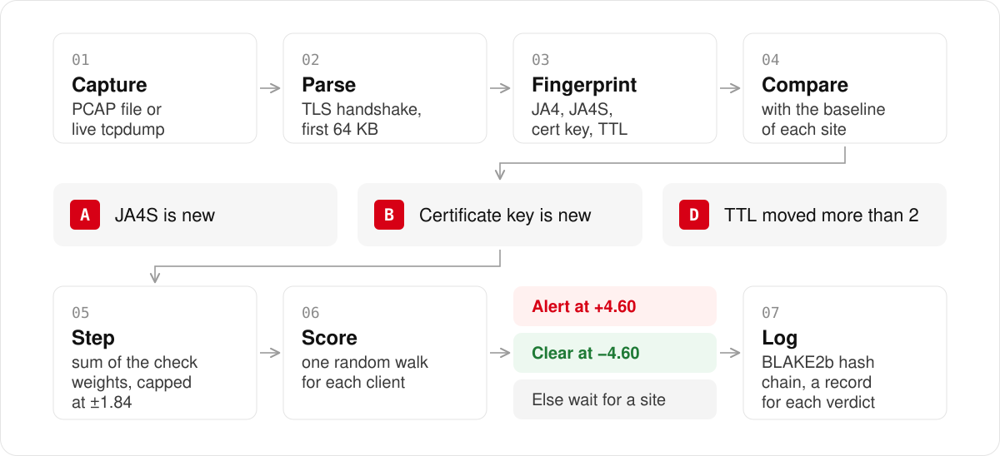
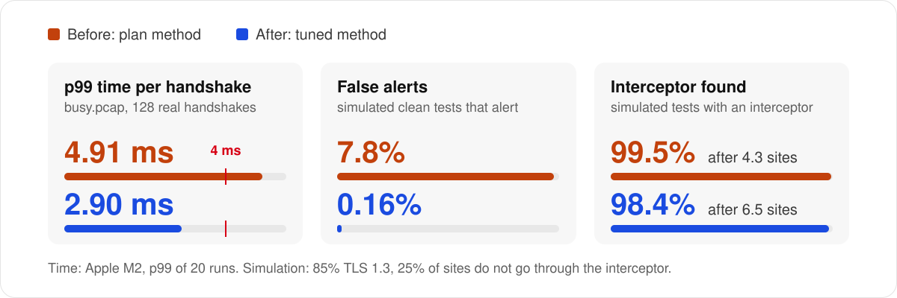

<p align="center">
  
</p>

<p align="center">
  <a href="https://zerohour-pi.vercel.app"><b>Live demo</b></a> ·
  <a href="#how-it-decides">How it decides</a> ·
  <a href="#quick-start">Quick start</a> ·
  <a href="#results">Results</a> ·
  <a href="https://www.icir.org/vern/papers/portscan-oak04.pdf">The TRW paper</a>
</p>

zerohour finds a TLS interceptor between a client and the internet. It does not decrypt the traffic. It reads only the
TLS handshakes, compares each site with a baseline that it learned before, and decides for each client with the
**Threshold Random Walk** (TRW). zerohour is our sensor for Zero Hour Track 2.

A forged certificate changes more than one thing. The server fingerprint, the certificate key and the network path can
all change at the same time. One change is normal: a server gets new software, a certificate is renewed, a route
changes. Many changes from many sites, one after the other, are not normal. TRW measures that sequence and gives an
alert after as few sites as possible.

## How it decides

<p align="center">
  
</p>

| Stage | What happens | Code |
|---|---|---|
| Capture | libpcap reads the packets. TCP reassembly keeps the first 64 KB of each direction. | `src/sensor.cpp` |
| Fingerprint | OpenSSL calculates JA4 and JA4S (SHA-256) and the hash of the certificate key (X.509). | `src/tls.cpp` |
| Checks | **A**: the JA4S is new. **B**: the certificate key is new. **D**: the TTL changed by more than 2. | `src/trw.cpp` |
| Step and score | The TRW adds a step to the score of the client. Each site counts one time in a test. | `src/trw.cpp` |
| Log | libsodium writes each notice and verdict to a hash-chained log (BLAKE2b). | `src/chainlog.cpp` |

## Built on the TRW paper

We took the concepts and models of zerohour from this paper:

> Jaeyeon Jung, Vern Paxson, Arthur W. Berger and Hari Balakrishnan.
> **Fast Portscan Detection Using Sequential Hypothesis Testing.** IEEE Symposium on Security and Privacy, 2004.
> [PDF](https://www.icir.org/vern/papers/portscan-oak04.pdf)

The paper finds port scanners: a remote host that makes many failed connections to new local hosts. We use the same
model for TLS: a client that gets many changed handshakes from known sites.

| Concept from the paper | In zerohour | Code |
|---|---|---|
| Sequential hypothesis testing | H0: no interceptor. H1: an interceptor. After each new site, the sensor accepts H0, accepts H1 or waits. | `src/trw.cpp` |
| One observation for each new destination | One handshake for each new site: it matches the baseline or it does not. Each site counts one time in a test. | `src/trw.cpp` |
| θ0 and θ1, the success rates under H0 and H1 | The match rates without and with an interceptor: 0.9 and 0.2, or the rates from `zerohour calibrate`. | `zerohour.conf` |
| Random walk of the likelihood ratio | Each client has a score. A mismatch adds `ln(0.8/0.1) = +2.08`. A match adds `ln(0.2/0.9) = −1.50`. | `src/trw.cpp` |
| Thresholds η1 = β/α and η0 = (1−β)/(1−α) | With α = 0.01 and β = 0.99: an alert at `+4.60`, clear at `−4.60`. A new test starts after each decision. | `src/trw.cpp`, `zerohour.conf` |
| Expected number of observations E[N\|H0] and E[N\|H1] | From eq. 14 of the paper. `zerohour calibrate` shows them and the number of mismatches in sequence that cause an alert. | `src/trw.h` |

**What we added:** the paper has one observation with two results. A handshake has three checks. The tuned method gives
each check its own weight (its log-likelihood ratio from calibration) and limits the step of one site to `±1.84`. Refer
to [Results](#results).

## Quick start

1. Install the dependencies. macOS has OpenSSL 3 and libpcap.

   ```sh
   brew install cmake libsodium googletest
   ```

2. Build the sensor.

   ```sh
   cmake -S . -B build && cmake --build build -j
   ```

3. Make the lab PCAP files. The lab makes real TLS 1.2 handshakes with OpenSSL memory BIOs and writes them to
   `lab/pcaps/*.pcap`.

   ```sh
   cmake --build build --target pcaps
   ```

4. Run the sensor.

   ```sh
   ./build/zerohour show  lab/pcaps/learn.pcap      # shows site, JA4, JA4S, key and TTL of each handshake
   ./build/zerohour learn lab/pcaps/learn.pcap      # writes baseline.tsv
   ./build/zerohour run   lab/pcaps/attack.pcap     # alert after 3 sites (+6.24); also use normal or onechange
   ./build/zerohour verify alerts.log               # checks the hash chain
   ./build/zerohour serve                           # starts the dashboard at http://127.0.0.1:8765/
   ```

## Results

Two constraints from our mentors: the time for each handshake must be less than 4 ms, and the sensor must give fewer
false alerts than the plan step of the paper.

<p align="center">
  
</p>

| | Before (`zerohour.conf`, plan method) | After (`zerohour.tuned.conf`, tuned method) |
|---|---|---|
| Step for each site | If a check fails: `+2.08`. If no check fails: `−1.50`. | The sum of the log-likelihood ratios (LLR) of the checks. The rates come from calibration. The cap is `±4.60/2.5`. |
| Evidence log | Each record waits for a full flush (`F_FULLFSYNC` / `fdatasync`). | Records use an ordered write (`F_BARRIERFSYNC`). Only alerts wait for a full flush. |
| p99 time for each handshake, `busy.pcap` (8 clients, 128 handshakes) | 4.91 ms (more than 4 ms) | 2.90 ms |
| p99 time for each handshake, `attack.pcap` (each site gives an alert or a notice) | 4.87 ms (more than 4 ms) | 3.50 ms |
| False alerts, simulated (85% TLS 1.3; 25% of sites do not go through the interceptor) | 7.8% of tests | 0.16% of tests |
| Detection, simulated | 99.5%, after 4.3 sites | 98.4%, after 6.5 sites |
| False alerts, real `busy.pcap` (6 clients without an interceptor) | 0 | 0 |

The times are the p99 of 20 runs on an Apple M2 (`site/data/bench.json`).

```sh
./build/zerohour bench lab/pcaps/learn.pcap lab/pcaps/busy.pcap -c zerohour.tuned.conf   # PASS or FAIL against 4 ms
./build/zerohour run lab/pcaps/multichange.pcap -c zerohour.tuned.conf                   # 4 normal changes: clear
```

> [!NOTE]
> **Trade-off:** An interceptor can copy the JA4S and the hop count of each server. Then only check B fails. The tuned
> method gives one failed check a small weight. Thus it finds this interceptor much less frequently.

The [`/tuning`](https://zerohour-pi.vercel.app/tuning) page shows how we chose the weights and the cap. The
[`/compare`](https://zerohour-pi.vercel.app/compare) page shows the two constraints.

## Calibrate θ0 and θ1

The `calibrate` command learns a baseline from one capture. Then it measures two rates:

- θ0: the match rate of a clean visit at a later time.
- θ1: the match rate through an interceptor.

Each rate is a Laplace estimate: (matches + 1) / (sites + 2). The command also shows the 95% range of the raw rate,
the steps, and the number of mismatches in sequence that cause an alert. It gives the two lines for `zerohour.conf`.

To calibrate on your network:

1. Record a capture to learn. The script uses `sudo tcpdump`. Go to 20 or more sites. Then push Ctrl-C.

   ```sh
   sh lab/capture.sh real-learn.pcap
   ```

2. Record a second capture one day later. Use the same network and the same sites.

   ```sh
   sh lab/capture.sh real-revisit.pcap
   ```

3. Calibrate.

   ```sh
   ./build/zerohour calibrate real-learn.pcap real-revisit.pcap lab/pcaps/attack.pcap
   ```

For an example, run `demo3/demo3.sh`. In `multichange.pcap`, 4 of 8 sites change in normal ways. The script
calibrates into `demo3/zerohour.conf` and runs the sensor again.

## Web console

The [`site/`](site/) folder is the demo on Vercel: static pages and Vercel functions in `site/api/`.

- The engine `site/lib/engine.js` is a port of `src/trw.cpp`. The test `node site/test/parity.mjs` compares it with
  the C++ sensor.
- The live replay reads `lab/pcaps/busy.pcap`: real lab handshakes from 8 clients. Two clients are behind an
  interceptor.
- `site/lib/sim.js` simulates the false alerts. `site/lib/tune.js` does the tuning sweep.

<details>
<summary><b>The pages</b></summary>

| Page | Contents |
|---|---|
| [`/`](https://zerohour-pi.vercel.app) Demo | **Live replay** of `busy.pcap` (8 clients, 16 sites each, 2 clients behind an interceptor). It shows the alerts, the false alerts and the p99 detection time. **Lab scenarios** shows the score after each site for the plan method and the tuned method: Normal, One change, Many changes and Attack. **Wireshark** shows the tshark view of `learn.pcap`, `multichange.pcap` and `attack.pcap`. You can download each file. **Evidence log**: your browser calculates the BLAKE2b-256 hash of each record again. "Change one record" breaks the chain. |
| [`/live`](https://zerohour-pi.vercel.app/live) | Live capture on real sites. Refer to the section below. |
| [`/how-live`](https://zerohour-pi.vercel.app/how-live) | The data path of live capture, the tools and their versions, and the changes that we made for live capture. |
| [`/tuning`](https://zerohour-pi.vercel.app/tuning) | How we chose the tuned method: measure p₀ and p₁ for each check, give each check a weight, select the cap. |
| [`/compare`](https://zerohour-pi.vercel.app/compare) | The two constraints, before and after: the p99 time less than 4 ms, and the false alerts (simulated and real). |

</details>

<details>
<summary><b>Deploy</b></summary>

- Each push to `main` deploys to production.
- For a manual deploy, run `vercel deploy --prod` from the repository root. The Root Directory of the Vercel project
  is `site/`.
- To make the fixtures again, run `sh site/scripts/fixtures.sh`.

</details>

### Live capture

The [`/live`](https://zerohour-pi.vercel.app/live) page records real handshakes to sites that you type. It uses only
the tuned method. The code is in `site/api/live.js`, `site/lib/live.js` and `site/lib/capture.sh`.

**Step 1, Learn:**

1. The function starts a Vercel Sandbox VM from a snapshot. The snapshot has tcpdump, mitmproxy and the sensor, built
   on Linux.
2. The VM is the network of the client. The client is in its own network namespace.
3. The client connects to each site one time. tcpdump records the client side of the link.
4. `zerohour show` reads each handshake. These handshakes are the baseline.

Each site keeps one IPv4 address for the full session.

**Step 2, Test:** The client connects to the same sites again, in the same VM. Then the VM stops. When you push Run
test again, a new VM learns the sites again before the test. Select a path and a scenario:

| Path | Scenario | Change |
|---|---|---|
| Direct | Normal | No change. |
| Direct | One change | One site gets a new route through 3 more routers. Check D fails. |
| Direct | Many changes | Up to 4 sites get new routes or new TLS settings (`curl --tls-max 1.2`). One site gets the two changes. |
| Through mitmproxy | Attack | All sites go through `mitmdump --mode transparent` on the gateway of the client. |

The page shows each handshake when it arrives: the checks, the step and the score. At +4.60, the page shows Alert. If
a test ends below the threshold, the page shows Clear. The VM keeps a hash-chained evidence log of the test. The page
verifies the log with BLAKE2b-256. You can download `learn.pcap` and each `test-N.pcap`.

The page is public. Thus it has these limits:

- Type 3 to 8 public host names or IPv4 addresses. The function refuses private, loopback, link-local and reserved
  addresses.
- A maximum of 4 VMs can run at the same time.
- A VM does one test. Then it stops, and the page says why.
- A VM without a test stops when you close the page, or after 5 minutes.

After a change to the sensor, make the snapshot again. Use a commit that you pushed:

```sh
cd site && node --env-file=../.env.local scripts/snapshot.mjs <pushed commit>
```

## Tests

```sh
(cd build && ctest)                              # GoogleTest for trw, chainlog and tls (37 tests, written before the code)
sh tests/calibrate_e2e.sh                        # E2E: calibrate with the lab PCAPs; writes e2e/artifacts/calibrate.txt
sh tests/wireshark_check.sh                      # compares tshark and the sensor: JA4, SNI, TTL, issuer and verdict; writes e2e/artifacts/wireshark.txt
node site/test/parity.mjs                        # makes sure that the web engine and the C++ sensor agree on each lab event
(cd e2e && npx playwright test -c site.config.ts) # E2E of the deployed site, with /live on real traffic; writes to e2e/artifacts/
cd e2e && npm install && npx playwright test     # E2E of the CLI and the 5 demo steps in the dashboard
npx playwright show-report artifacts/report      # opens the HTML report, with a trace and a video for each test
```

To debug with sanitizers, build with `cmake -S . -B build-asan -DZH_ASAN=ON`.

## Reference

Jaeyeon Jung, Vern Paxson, Arthur W. Berger and Hari Balakrishnan. *Fast Portscan Detection Using Sequential
Hypothesis Testing.* IEEE Symposium on Security and Privacy, 2004.
[https://www.icir.org/vern/papers/portscan-oak04.pdf](https://www.icir.org/vern/papers/portscan-oak04.pdf)
